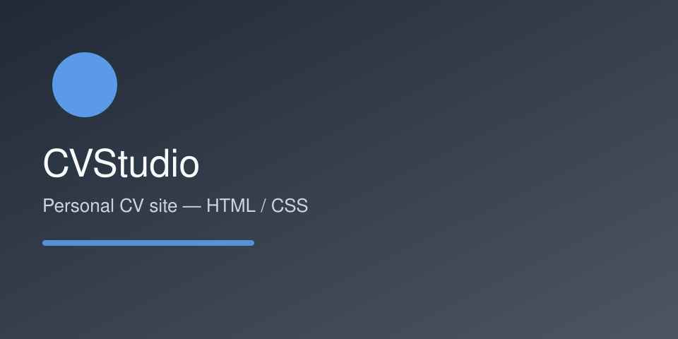

# CVStudio

Personal CV site — static HTML and CSS, one stylesheet, no build step.



## What this is

A single-page CV that renders from plain HTML and a hand-written stylesheet. The `src/` tree keeps the Pug and SCSS sources for anyone who wants to regenerate markup, but the published page under `index.html` is plain HTML/CSS so it stays readable and cheap to host.

## Layout

```
index.html            published page
assets/css/styles.css hand-written stylesheet
src/                  Pug + SCSS sources
docs/                 screenshots
```

## Getting started

Open `index.html` in a browser. No build step required.

## Licence

MIT © 2026 Walid Boussou
